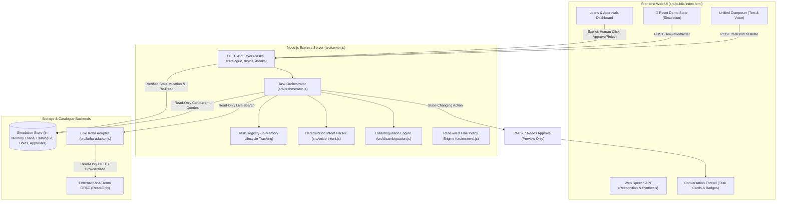

# Library Hold & Renewal Agent

**An AI library assistant for loan management, edition disambiguation, hold reservations, and concurrent task orchestration.**

A safe, accessible, agentic conversational AI interface for students and library patrons that resolves book edition ambiguity, plans and executes concurrent information retrieval tasks, checks loan renewals and hold eligibility, and strictly gates simulated consequential state changes behind explicit human approval.

Built for the **Agentic AI Hackathon 2026**, powered by **Ziro.Digital**.

---

## 1. Problem Being Solved & Target Users

### The Problem
Traditional Integrated Library Systems (ILS) and Online Public Access Catalogues (OPACs) like Koha present several usability challenges:
- **Edition Ambiguity**: Multi-edition textbooks (e.g., 2nd vs 3rd vs 7th editions) cause accidental holds on obsolete or incorrect volumes.
- **Opaque Renewal Rules**: Students frequently face unexpected loan renewal blocks caused by invisible hold queues from other patrons, fine accumulation (assessed at ₹5/day in INR), or exceeded renewal counts.
- **Clunky Non-Conversational Search**: Searching requires knowing exact keywords or boolean syntax, with zero conversational support for natural inquiries like *"Find Data Science and Algorithm and tell me if it is available."*
- **Chatbot Hallucinations vs Real Library Actions**: Generic LLM chatbots either hallucinate actions that never occurred or execute uncontrolled state mutations against live circulation databases without verified safety gates.

### Target Users
- **University Students & Faculty**: Need rapid, natural-language answers about textbook editions, shelf availability, personal loan due dates, and queue positions.
- **Library Administrators & Circulators**: Require guaranteed safety boundaries where conversational interfaces cannot perform rogue or unverified mutations on circulation databases.

---

## 2. Key Features & The Agentic Approach

- **Non-Blocking Concurrent Task Orchestration (Phase 5 & 6)**: The message composer remains active and responsive while earlier tasks are in flight. Out-of-order completions attach strictly to their originating message cards without race conditions or card overwrites.
- **Multi-Intent Planning & Dependency Resolution**: The agent analyzes complex compound transcripts (e.g. *"Find Data Science and Algorithm and tell me if it is available"* or *"Show my loans and list my pending holds"*), mapping subtasks to concurrent execution via `Promise.all` or sequential data dependencies.
- **Deterministic Offline Voice & Text Parsing**: A 72-case strict natural-language parser (`src/voice-intent.js`) runs offline with zero cloud API dependencies, recognizing titles with "and", author searches, subject queries, identifiers/ISBNs, and availability checks.
- **Strict Human Approval Gate**: Read-only queries execute freely, but state-changing simulated actions (`RENEWAL`, `HOLD`, `HOLD_CANCELLATION`) strictly halt at `Needs approval` (`previewOnly: true`). Consequential updates happen **only** when a human explicitly clicks Approve.
- **Dual Catalogue Modes**: Seamlessly toggle between the verified in-memory **Simulation catalogue (default)** and the read-only **Live Koha OPAC**.
- **Interactive Voice Mode & Push-to-Talk**: Browser-native Web Speech recognition (`SpeechRecognition`) and speech synthesis (`speechSynthesis`) with instant interrupt controls (`⏹️ Stop Listening`, `🔇 Stop Speaking`).
- **Client Cancellation & Failure Recovery**: Users can cancel long-running queries via `AbortController` and `POST /tasks/:id/cancel` with clear transparency notices, or retry failed queries without resubmitting unrelated tasks.
- **Deterministic Demo Reset**: One-click simulation state reset (`POST /simulation/reset`) restores clean fixtures, ensuring predictable, repeatable demonstrations.

---

## 3. System Architecture & Information Flow



---

## 4. Technology Stack

Based strictly on packages and code present in the repository:
- **Backend Runtime**: Node.js (v18+ recommended, CommonJS modules)
- **Web Framework**: Express (v5.3.0)
- **Testing Engine**: Built-in Node.js Test Runner (`node:test`, `node:assert/strict`) — zero external test dependencies
- **Live Search & Automation**: `@browserbasehq/stagehand` (v4.2.1), `zod` (~4.4.3), `dotenv` (^18.0.8)
- **Frontend Architecture**: Vanilla HTML5, CSS3 (CSS Variables, Flexbox, CSS Grid, mobile media queries), modern JavaScript (ES2022, `fetch`, `AbortController`), Web Speech API (`SpeechRecognition`, `speechSynthesis`)

---

## 5. Installation & Environment Setup

1. **Clone or Navigate to the Repository**:
   ```powershell
   cd C:\Users\vivek\library-agent
   ```

2. **Install Dependencies**:
   ```powershell
   npm.cmd install
   ```

3. **Configure Environment Variables (Optional for Offline Simulation)**:
   Create a `.env` file in the project root if testing live Koha OPAC via Browserbase:
   ```env
   PORT=3000
   KOHA_CATALOGUE_URL=http://opacdemo.kohasupport.com
   # Optional: Browserbase keys for stagehand-smoke.mjs
   # BROWSERBASE_API_KEY=your_key_here
   # BROWSERBASE_PROJECT_ID=your_project_id_here
   ```
   > [!NOTE]
   > All core simulation, intent parsing, task orchestration, and acceptance test suites run 100% offline without requiring any third-party API keys. Never commit `.env` or patron credentials.

---

## 6. Execution Commands (Windows PowerShell)

### Start the Server
```powershell
npm.cmd start
```
*Access the interface at: `http://localhost:3000`*

### Run the Full Automated Test Suite (171 Tests)
```powershell
npm.cmd test
```

### Run Focused Sub-Suites
```powershell
# 72-case strict natural-language regression suite
npm.cmd run test:regression

# Phase 5 agentic workflow orchestrator suite
npm.cmd run test:orchestrator

# Core demo readiness & live scenario suite
npm.cmd run test:demo
```

---

## 7. Live Demonstration Script (Step-by-Step)

Before beginning a demonstration, click **🔄 Reset Demo State** in the top navigation bar (or call `POST /simulation/reset`) to ensure clean fixtures.

### Scenario A — Catalogue Search & Item Availability
- **Input**: `Find Data Science and Algorithm and tell me if it is available.`
- **Expected Behavior**:
  - Orchestrator identifies `sequential_dependent` strategy.
  - Subtask 0 searches the catalogue $\rightarrow$ resolves `CAT-005` (*Data Science and Algorithm* by Steven S. Skiena).
  - Subtask 1 checks availability directly for `CAT-005` $\rightarrow$ reports `2 copy/copies available (total copies: 2). Shelf status: Ready for checkout.`
  - The entire workflow runs in a single assistant message bubble with task status `✅ Completed`.

### Scenario B — Non-Blocking Concurrent Requests
- **Action**: In the composer, type and submit `Show my loan books`. Immediately, without waiting, type and submit `Show me the newest books`.
- **Expected Behavior**:
  - Both tasks display distinct client task IDs (e.g. `[task-...1]` and `[task-...2]`).
  - The composer remains active throughout.
  - Subtask results attach strictly to their originating cards.
  - Both cards transition to `✅ Completed` independently.

### Scenario C — Compound Read-Only Inquiry
- **Input**: `Show my loans and list my pending holds.`
- **Expected Behavior**:
  - Strategy: `concurrent_read_only`.
  - Subtask 0 retrieves simulated student loans (e.g. `BOOK-001`, `BOOK-002`, `BOOK-003`, `BOOK-004`).
  - Subtask 1 inspects active hold reservations and pending queue approvals.
  - Both result groups render cleanly grouped under one message.

### Scenario D — Renewal & Hold Human Approval Gate
- **Input**: `Renew my books and reserve Operating System Concepts.`
- **Expected Behavior**:
  - Decomposes into two preview cards: *Renewal Request (Approval Required)* and *Hold Request (Approval Required)*.
  - Lifecycle badge halts at `⏸️ Needs approval`.
  - **Zero Backend Mutation**: No loan due date is extended and no hold queue is altered.
  - Clicking **View Loans & Approvals →** takes the user to the approvals dashboard where explicit human approval is required.

### Scenario E — Cancellation & Failure Recovery
- **Input**: Submit a query and immediately click the **Cancel / Stop waiting** button.
- **Expected Behavior**:
  - Status updates immediately to `⏹️ Cancelled`.
  - Fetch is aborted on client (`AbortController`) and registered on server (`POST /tasks/:id/cancel`).
  - Displays transparent notice: *"Request was cancelled by user. Note: cancelling stops waiting for the response; any operation already executed on the backend is not rolled back."*
  - Any failed request displays a **↻ Retry task** button allowing immediate re-execution.

### Scenario F — Live Koha Safety & Error Boundary
- **Action**: Switch source dropdown to **Live Koha OPAC (read-only)** and search `Operating`.
- **Expected Behavior**:
  - Response contract returns `mode: "live_koha"`, `safetyMode: "read_only"`.
  - Live write actions remain completely disabled.
  - If external network or Koha service is unreachable, returns 502 with sanitized message and zero credential leakage.

---

## 8. Task Orchestration & Lifecycle Specification

Each conversational request proceeds through defined lifecycle states managed by `TaskRegistry` in `src/orchestrator.js`:

| State | Badge | Description |
|---|---|---|
| `QUEUED` | `⏳ Queued` | Request registered, waiting to be executed |
| `PROCESSING` | `🔄 Processing…` | Subtask(s) actively executing concurrently or sequentially |
| `NEEDS_APPROVAL` | `⏸️ Needs approval` | Paused waiting for explicit human button confirmation |
| `COMPLETED` | `✅ Completed` | All subtasks finished successfully |
| `FAILED` | `❌ Failed` | One or more subtasks encountered an error (independent subtasks still display) |
| `CANCELLED` | `⏹️ Cancelled` | Aborted by user before completion |

### Execution Strategies
1. `single_query`: Simple single-intent request (e.g. search, hours inquiry).
2. `concurrent_read_only`: Multiple independent queries executed simultaneously via `Promise.all` (e.g. loans + holds).
3. `sequential_dependent`: Downstream subtask depends on upstream resolution (e.g. book search $\rightarrow$ copy availability).
4. `approval_gated`: Contains state-changing intent (`RENEWAL`, `HOLD`). Halts at preview stage until human confirmation.

---

## 9. Truthful Distinction: Simulation vs Live Koha

| Aspect | Simulation Mode (Default) | Live Koha Catalogue |
|---|---|---|
| **Data Source** | Deterministic in-memory synthetic patron records and catalogue | Public Koha demo OPAC (`opacdemo.kohasupport.com`) |
| **Search Capabilities** | Disambiguation, new arrivals, author/subject/ISBN | Real-time live OPAC scraping via Stagehand/Browserbase |
| **Loan Inspection** | Synthetic student loans (`BOOK-001` to `BOOK-004`) | `LIVE_PATRON_ACCESS_UNAVAILABLE` on unauthenticated OPAC |
| **Holds & Renewals** | Verifiable simulated workflow with queue position calculation | **Strictly Disabled** (Read-Only Safety Boundary) |
| **Fines Calculation** | ₹5/day synthetic fine policy in INR | Restricted to staff circulation desk |

---

## 10. Known Limitations

1. **No Authenticated Live Patron Session**: The live Koha integration queries public bibliographic OPAC pages only. Real-world patron writes (placing actual circulation holds or checkouts) require authenticated HTTPS patron sessions and staff authorization, which are intentionally omitted for safety.
2. **In-Memory Volatility**: Simulated loans, holds, and approvals reside in server memory. Restarting the server resets state to the default fixtures. Use **🔄 Reset Demo State** to reset on demand during presentations.
3. **Speech Recognition Browser Support**: Web Speech API (`SpeechRecognition`) is supported in Chromium-based browsers (Google Chrome, Microsoft Edge). Non-supporting browsers gracefully fall back to typed text input.

---

## 11. Complete Test Execution Results

All tests execute via native Node.js test runner (`node --test`):

```
✔ TC1: Normal Renewal Flow - Two books renewed and verified in simulation (213ms)
✔ TC2: Hold Queue Protection - Reservation blocks renewal with expected return date (40ms)
✔ TC3: Catalogue Disambiguation - Same work editions vs distinct works (26ms)
✔ Phase 4.2 Fix: New Arrivals - Listing request returns sorted records without selection gate (38ms)
✔ Phase 4.2 Fix: Recently Acquired query also treats results as listing (16ms)
✔ Phase 4.2 Fix: Live Search preserves read-only mode and discovery flags (13ms)
✔ TC4: Renewal Limit & Synthetic Overdue Fine Policy (22ms)
✔ TC4 Helper: calculateSyntheticFine handles current, overdue, and invalid dates (0.7ms)
✔ Renewal Request Idempotency & Single Pending Approval Enforcement (91ms)
✔ Phase 2.3: Live Catalogue Search - Injected adapter receives query and returns structured results (10ms)
✔ Phase 2.3: Live Catalogue Search - Query validation rejects empty and oversized queries (35ms)
✔ Phase 2.3: Live Catalogue Search - Adapter failure returns 502 without leaking secrets (10ms)
✔ Phase 2.3: Live Catalogue Search - Disambiguation flags and diagnostic statuses propagate (7ms)
✔ Phase 2.3.1: Hold Workflow - Request hold creates pending approval without modifying queue (58ms)
✔ Phase 2.3.1: Hold Workflow - Rejection does not alter queue and cannot be re-executed (29ms)
✔ Phase 2.3.1: Hold Idempotency - Same request ID reuses response (79ms)
✔ Phase 2.3.1: Hold Workflow - Input validation and catalogue edition resolution (58ms)
✔ Phase 2.3.1: Hold Queue - Deterministic position calculation with baseline queue count (31ms)
✔ Phase 2.3.1: Hold State Inspection - GET /holds exposes active holds and pending approvals (29ms)
✔ Scenario A — Catalogue search and availability: 'Find Data Science and Algorithm' (146ms)
✔ Scenario B — Concurrent independent requests: 'Show my loan books' and 'Show newest books' (37ms)
✔ Scenario C — Compound read-only task: 'Show my loans and list my pending holds.' (24ms)
✔ Scenario D — Renewal and hold approval: 'Renew my books and reserve OS Concepts.' (18ms)
✔ Scenario E — Cancellation and failure recovery (24ms)
✔ Scenario F — Live Koha safety and error sanitization (23ms)
✔ Scenario G — Deterministic Demo Reset: POST /simulation/reset restores clean baseline (15ms)
✔ Phase 5 Orchestrator: 13 tests covering concurrency, out-of-order, isolation, compound plans (550ms)
✔ Phase 4.2 Strict 72-Case Regression Suite: 73 tests verifying all intent categories (414ms)
✔ Phase 4.2 Expanded Voice Intent Suite: 44 tests for author, subject, ISBN, availability (350ms)

Total: 171 tests passed, 0 failed, 0 skipped across 6 test suites (~1.17s total duration)
```

---

## 12. Complete API Reference

| Method | Route | Description |
|---|---|---|
| `GET` | `/` | Web chat interface and client dashboard |
| `GET` | `/health` | Lightweight service health check (`{ ok: true }`) |
| `POST` | `/tasks/orchestrate` | Coordinate compound/concurrent tasks, parse intents, execute safely |
| `GET` | `/tasks/:id` | View task lifecycle status and subtask results from registry |
| `POST` | `/tasks/:id/cancel` | Cancel in-flight task tracking in registry (does not rollback backend) |
| `POST` | `/simulation/reset` | Deterministic demo reset: restores simulation store to clean baseline |
| `GET` | `/books` | View simulated patron loans (filter with `?studentId=STU-001`) |
| `GET` | `/catalogue` | List all synthetic catalogue items |
| `GET` | `/catalogue/search?q=...` | Search simulation catalogue with disambiguation |
| `GET` | `/catalogue/live-search?q=...` | Search live Koha OPAC (read-only, via Stagehand adapter) |
| `POST` | `/check-renewal` | Check eligibility, expected return dates, and fine estimates |
| `POST` | `/request-renewal` | Idempotent renewal request (requires `bookId`, `requestId`) |
| `POST` | `/approvals/:id/approve` | Approve renewal, advance due date (+14d), re-read & verify |
| `POST` | `/approvals/:id/reject` | Reject pending renewal approval |
| `POST` | `/approvals/:id/undo` | Undo a previously approved simulated renewal |
| `POST` | `/request-hold` | Idempotent hold request on specific edition |
| `POST` | `/holds/:id/approve` | Approve pending hold, assign queue position, place simulated hold & verify |
| `POST` | `/holds/:id/reject` | Reject pending hold approval without altering queue |
| `GET` | `/holds` | View simulated hold records and pending approvals |
| `POST` | `/voice/parse` | Parse spoken or typed command into deterministic structured intents (read-only) |
| `GET` | `/audit` | View recorded audit trail |
